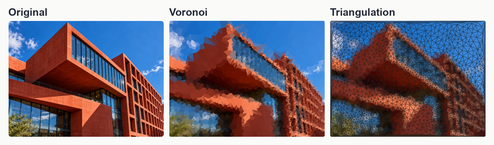

# Math Lens

Math Lens is an interactive creative computing project exploring how different
mathematical representations reveal different ways of seeing the same image.
**Voronoi** emphasizes regions, color, and adaptive sampling; **Triangulation**
emphasizes structure, connectivity, and mesh exploration.



The figure combines genuine application captures using the included architecture
input. The lenses use their own sampling settings; this is a visual comparison,
not a claim that both panels share identical sites. See [figure provenance](docs/figures/README.md).

## Implemented experience

- Interactive semantic controls, presets, and reproducible pattern seeds.
- Adaptive Voronoi regions with mean-region or seed-sampled color, centered-SVD
  tonal analysis, and Sobel structure features.
- Delaunay triangulation with Lloyd relaxation, mean-vertex or Gouraud color,
  and a Mesh Explorer with independent edge-color and RGB-width encodings.
- Explanatory process views in fixed pipeline order; visibility choices do not
  reorder the stages.
- Local-brush **Layer Reveal** through six prepared representations, with
  pause/resume, preview, reset, and tab-local history. Focus the canvas:
  **S** starts/resumes and **Q** pauses.
- PNG/config downloads, command-line pipelines, and controlled analysis tools.

## Technology and current status

Python and Streamlit provide the application; NumPy, SciPy, Pillow, and
Matplotlib provide numerical/image processing and visualization. A custom
HTML Canvas/JavaScript component implements Layer Reveal. Tests use pytest,
Streamlit AppTest, and Node's built-in test runner.

This is a working local research/art prototype (package version `0.1.0`),
prepared for its first public repository release. It is a Python/Streamlit
application, not a GitHub Pages site. No hosted live demo or completed public
exhibition is claimed. Licensing and upstream provenance remain subject to
review; see [attribution and publication notes](ATTRIBUTION.md).

## Future directions (not implemented)

Possible directions include a Path Lens and AR/spatial exploration of image
representations. These are proposals, not existing application features.

## Local installation

Use Python 3.13 for the currently tested environment. The package metadata
permits Python 3.10+, but older versions have not been validated for this release.
From the repository root:

```bash
python3 -m venv .venv
source .venv/bin/activate
python -m pip install -e '.[dev]'
python -m streamlit run app.py
```

On Windows, activate with `.venv\Scripts\Activate.ps1`. For the exact tested
runtime/test dependency versions instead of resolving newer versions:

```bash
python -m pip install -r requirements-tested.txt
python -m pip install --no-deps -e .
```

`requirements-tested.txt` records the Python 3.13 macOS environment; it is a
version snapshot, not a cross-platform, hash-locked build. `requirements.txt`
remains the small unpinned runtime dependency list. Editable installation uses
the setuptools build backend specified in `pyproject.toml`.

## Example input and usage

The public repository includes two intentional demonstration inputs under
`assets/inputs/portfolio/`: an architectural facade and a colored-glass still
life. Both PNGs were AI-generated as demonstration inputs for Math Lens.
Upload either PNG using the sidebar **Image** control, then select a lens
and adjust its controls. Public checkouts initially ask for an upload: the
optional local `assets/inputs/example.JPG` is excluded pending permission review.
Switching lenses requires selecting/uploading the input for that lens as well.

The CLI examples below use the included architecture PNG and write generated
files to the ignored `outputs/` directory. No API keys or remote services are
required by the application.

## Testing

```bash
python -m pytest -q
node --test tests/test_reveal_state.cjs
python -m math_lens.cli --help
python -m math_lens.cli voronoi --help
python -m math_lens.cli triangulation --help
```

Node.js is needed only for the JavaScript tests, not to run the Streamlit app.
UI tests explicitly load a public demo input and do not require the optional
private photograph. The sections below preserve the technical pipeline details.

## Project progression

### 1. Baseline Voronoi

```text
image -> uniform points -> nearest-seed Voronoi partition -> mean cell color
```

### 2. Adaptive Voronoi

```text
image -> image features -> density map -> adaptive points -> Voronoi -> mean cell color
```

Low-level adaptive mode exposes the density weights, coarse/fine point counts, blur, and density power directly for experiments.

### 3. Voronoi Lens

```text
image
  -> high-level visual controls
  -> mapped algorithm parameters
  -> adaptive points
  -> Voronoi partition
  -> regional color interpretation
```

Lens controls are interaction-level choices, not mathematically fundamental Voronoi parameters. They map to the existing adaptive algorithm in a documented, linear way:

- **Abstraction** — `0` uses 5,000 smaller cells and little density blur; `1` uses 500 larger cells and more blur.
- **Detail Emphasis** — moves the fine-point share from 40% to 90% and increases density sharpening. Higher values concentrate more sites around strong features.
- **Structure vs Tone** — directly crossfades the density map from broad tonal
  variation in a low-rank SVD of centered luminance (`0`) to local Sobel edges
  (`1`). Subtracting global mean brightness keeps the decomposition focused on
  tonal variation. The SVD rank is selected automatically as the smallest rank
  retaining 90% of centered squared singular-value energy.
- **Color Mode** — `mean` uses the average source color within each cell; `seed` uses the source color sampled at the cell's generating site.

Three presets provide useful starting points. Explicit controls override individual preset values:

| Preset | Abstraction | Detail emphasis | Structure | Color |
| --- | ---: | ---: | ---: | --- |
| `detailed` | 0.15 | 0.75 | 0.85 | mean |
| `balanced` | 0.50 | 0.55 | 0.75 | mean |
| `abstract` | 0.85 | 0.35 | 0.65 | mean |

Both lenses are available in the Streamlit application and through the CLI
below. A Path Lens remains a future direction.

## Interactive demo

```bash
streamlit run app.py
```

Upload an included public demo PNG, or your own JPG/JPEG/PNG. The app also uses
the optional local `assets/inputs/example.JPG` when it exists; that photograph
is not distributed in the public file set. The large Voronoi result updates automatically as presets,
sliders, or color interpretation change. Controls lead with semantic ranges:
**Detailed ↔ Abstract**, **Global ↔ Detail-focused**, and **Tone-focused ↔
Structure-focused**; percentages remain secondary for fine-grained control. A
fixed pattern seed keeps changes visually comparable; **Regenerate Pattern**
intentionally creates a new realization. **Show Process** keeps selected views
in canonical pipeline order: Original, Density Map, Seed Distribution, then
Voronoi Cells. The latter draws the nearest-site cell boundaries before color
is assigned. An optional collapsed comparison places a uniform result beside
the Lens using the same number of sites. Tone, Balanced, and Structure quick
buttons set the Structure vs Tone control to 0.0, 0.5, and 1.0 for demonstrations
while leaving the continuous slider available for fine adjustment.

The interactive preview is limited to 600 pixels on its longest side for live
response. Image resizing, SVD tonal analysis, and Sobel edges are cached
independently from parameter-dependent sampling and rendering. A collapsed
**Feature Analysis** section shows the display reconstruction (`X_k + μ`), the
centered SVD tone map (`normalize_01(abs(X_k))`), and the Sobel structure map,
together with the selected rank and retained energy, without changing the
canonical process-view pipeline. The process panel
also explains that its Density Map represents sampling probability rather than
ordinary grayscale brightness. You can download the current result and its JSON
configuration. UI runs remain in memory; use the CLI commands below when you
want saved experiment artifacts at the CLI's selected resolution.

- **Abstraction:** detailed/smaller cells at 0; abstract/larger cells at 1.
- **Detail Emphasis:** broadly distributed sites at 0; sites concentrated on
  local image features at 1.
- **Structure vs Tone:** SVD-derived global tonal density at 0;
  Sobel/structure-driven density at 1.
- **Color Interpretation:** mean color of a region, or color sampled at its
  seed site.

The uniform baseline uses random sites; the low-level adaptive mode exposes
sampling parameters directly; Lens mode maps these four visual controls onto
the same adaptive sampler and renderer. The demo exposes Lens mode only.

## Uniform baseline

```bash
python -m math_lens.cli voronoi \
  --input assets/inputs/portfolio/architecture_geometric_facade_4x3.png \
  --output outputs/voronoi_uniform \
  --sampling uniform \
  --points 1000 \
  --seed 10 \
  --max-size 1000
```

## Low-level adaptive mode

```bash
python -m math_lens.cli voronoi \
  --input assets/inputs/portfolio/architecture_geometric_facade_4x3.png \
  --output outputs/voronoi_adaptive \
  --sampling adaptive \
  --coarse-points 400 \
  --fine-points 1600 \
  --seed 10 \
  --max-size 1000 \
  --density-mode mix \
  --tone-method svd \
  --svd-energy-threshold 0.90 \
  --edge-weight 0.85 \
  --tone-weight 0.15 \
  --blur-sigma 6.0 \
  --density-power 2.0 \
  --point-jitter 0.0
```

## High-level Lens mode

Use direct controls:

```bash
python -m math_lens.cli voronoi \
  --input assets/inputs/portfolio/architecture_geometric_facade_4x3.png \
  --output outputs/voronoi_lens \
  --sampling lens \
  --abstraction 0.5 \
  --detail-emphasis 0.6 \
  --structure 0.85 \
  --color-mode mean \
  --seed 10 \
  --max-size 1000
```

Or use a preset:

```bash
python -m math_lens.cli voronoi \
  --input assets/inputs/portfolio/architecture_geometric_facade_4x3.png \
  --output outputs/voronoi_lens_balanced \
  --sampling lens \
  --preset balanced \
  --seed 10 \
  --max-size 1000
```

For example, `--preset balanced --color-mode seed --structure 0.9` keeps the balanced preset's other values while overriding its color and structure.

Use `--tone-method luminance` to reproduce the former raw-luminance tone
feature for comparisons. Uniform mode writes a three-panel comparison.
Adaptive and Lens modes write `01_original.png`, `02_density.png`,
`03_points.png`, `04_voronoi.png`, and a four-panel `05_comparison.png`. Every
run also saves `points.npy` and `config.json`; Lens configs include the
high-level controls, resolved low-level parameters, tone method, SVD energy
threshold, selected rank, actual retained energy, centering flag, and luminance
mean.

Use `python -m math_lens.cli voronoi --help` for all options.

## Week 4: centered-SVD rank study

The controlled rank study holds the image, Lens controls, sampler seed, and
Voronoi renderer fixed while changing only the centered-SVD reconstruction rank.
It does not add or use triangulation.

```bash
python -m math_lens.analysis.svd_rank_study \
  --input assets/inputs/portfolio/architecture_geometric_facade_4x3.png \
  --output outputs/svd_rank_study \
  --ranks 1 2 5 10 \
  --max-size 1000 \
  --seed 10
```

The study writes `svd_rank_panel.png`, `singular_value_decay.png`, and
`rank_metrics.csv`, plus reconstruction, tone map, density, sampled-site, and
final Voronoi images under each `rank_XX/` directory. The regular app and CLI
continue to select the smallest rank retaining 90% centered singular-value
energy; fixed-rank reconstruction is used only when explicitly requested by
analysis code.

## Triangulation Lens

The Triangulation Lens sees connectivity, mesh, and a structural skeleton.
It uses `scipy.spatial.Delaunay(points).simplices`, which contains triples of
site indices. Delaunay is the geometric dual of Voronoi for the same sites:
neighboring Voronoi cells induce connections between sites. Delaunay triangles
have the empty circumcircle property: no other site lies inside a triangle's
circumcircle. Cocircular sites can admit more than one valid connectivity.

```bash
python -m math_lens.cli triangulation \
  --input assets/inputs/portfolio/architecture_geometric_facade_4x3.png \
  --output outputs/triangulation_baseline \
  --preset balanced \
  --seed 10 \
  --max-size 1000
```

| Control | Endpoints | Mapping |
| --- | --- | --- |
| Structural Resolution | Sparse -> Dense | `round(400 + 4600 * value)` total sites |
| Regularity | Organic -> Regular | `round(4 * value)` Lloyd iterations |
| Structure Emphasis | Broad -> Edge-focused | uniform-to-Sobel density blend; fine share 40% -> 90%; density power 1 -> 4 |
| Mesh Visibility | Faint -> Visible | line width 0.5 -> 2 pixels; opacity 0 -> 1 |

The default controls are resolution 0.50, regularity 0.50, structure emphasis
0.80, and mesh visibility 0.70. Adaptive sampling reuses the shared sampler
and Sobel feature; coarse blur is fixed at 6 pixels. `--sampling uniform`
uses the same point count and seed with uniform placement. Four corner sites
are included in the total and pinned to cover the entire rectangular image.
Sampling coordinates are scaled onto `[0, width-1] x [0, height-1]`; geometry
uses `(x, y)`, image samples use `[y, x]`, and y increases downward.

Lloyd relaxation constructs a Voronoi diagram each step, clips each cell to
the image rectangle using neighbor bisectors, computes its exact polygon area
centroid, and moves all interior sites simultaneously. It uses ordinary
unweighted centroids. A few steps improve spacing; many steps would reduce
the concentration around image edges. The shared implementation is in
`math_lens.core.geometry.lloyd_relax_points`.

`--color-mode mean_vertex` averages the RGB samples at each triangle's three
vertices and fills the triangle with that color. `--color-mode gouraud`
interpolates the vertex samples with barycentric coordinates. This is RGB
interpolation, not averaging source pixels inside a triangle.
`--render-mode filled` omits edges, `filled_mesh` overlays edges (default),
and `mesh` renders only geometry. The separate mesh diagnostic always uses
opaque lines on white so it remains readable even when colored-mesh opacity
is zero.

Presets are optional, and explicit flags override their individual controls:

| Preset | Resolution | Regularity | Structure | Visibility |
| --- | ---: | ---: | ---: | ---: |
| sparse | 0.10 | 0.50 | 0.50 | 0.55 |
| balanced | 0.50 | 0.50 | 0.80 | 0.70 |
| structural | 0.80 | 0.25 | 0.95 | 0.90 |

Each run saves:

```text
01_original.png
02_points_initial.png
03_points_relaxed.png
04_triangulation_mesh.png
05_triangulation_color.png
06_comparison.png
07_voronoi_vs_triangulation.png
points_initial.npy
points_relaxed.npy
triangles.npy
config.json
```

The four-panel comparison shows Original, Final Sites, Mesh, and Colored
Triangulation. The dual geometry comparison uses exactly the final sites in
`points_relaxed.npy` for both diagrams; it does not resample. Use
`--no-voronoi-comparison` to omit it. Metadata records resolved controls,
point/triangle counts, Lloyd steps, corner anchors, coordinate convention,
and minimum-angle mesh-quality summaries.

For a controlled Lloyd comparison, repeat the balanced command with
`--regularity 0.0 --output outputs/triangulation_no_lloyd`, then with
`--regularity 0.5 --output outputs/triangulation_lloyd_moderate`. Both use
the same seed and initial sites.

## Week 5: Triangulation Explorer and Layer Reveal

Launch the existing application and choose **Voronoi** or **Triangulation** in
the sidebar:

```bash
.venv/bin/python -m streamlit run app.py
```

Both pages keep an aspect-preserving result in a centered 88%-width frame,
up to 1100 pixels wide (full-width frame on narrow screens). Static results
and the reveal canvas share a height budget of viewport height minus 280 pixels,
capped at 780 pixels, with slightly tighter main-page top spacing. Short screens
may still need scrolling, but normal desktop views keep the complete image visible.
Native static-image fullscreen controls and original-resolution downloads are
unchanged. Triangulation keeps one prominent result above collapsed process views. Structural
Resolution (Sparse/Dense), Regularity (Organic/Regular), Structure Emphasis
(Broad/Edge-focused), and Mesh Visibility (Subtle/Explicit) use semantic sliders.
Mesh Visibility and Mesh Encoding appear only in Mesh Explorer; Color Rendering
and Layer Reveal appear only in Colored Triangulation. Hidden controls retain
their selections when switching modes. Switching to Mesh Explorer pauses reveal.
After Image and Preset setup, the sidebar order is Structural Resolution,
Regularity, Structure Emphasis, then Display Mode. Colored mode follows with
Color Rendering and Layer Reveal; Explorer follows with Mesh Visibility and
Mesh Encoding (Edge Color, Edge Width).
**Colored Triangulation** supports mean-vertex and interpolated (Gouraud) color.
**Mesh Explorer** leaves the interiors white and provides independent controls:

- Edge Color: Monochrome or Local Image Color.
- Edge Width: Uniform, R, G, or B.

For each triangle, sample the source at its clamped, floored `(x, y)` centroid.
An interior edge averages the samples from its two adjacent triangles; a
boundary edge uses its sole triangle's sample. RGB width uses this same local
color even when the edge itself is drawn monochrome. Width is linear in the
selected channel divided by 255. Explorer visibility maps uniform width from
0.8 to 2 pixels, minimum channel width from 0.75 to 1 pixel, maximum channel
width from 2 to 3 pixels, and opacity from 0.55 to 1. The encodings can be
combined, and the lower width bound stays visible.

Process visibility follows a fixed order: Original, Initial Points, Lloyd
Relaxation, Relaxed Points, Triangulation Mesh. The Lloyd image illustrates
the first actual step using hollow old sites, filled dark cell centroids,
movement arrows, and subtle old Voronoi cell boundaries. It emphasizes at
most one moving site per 50-pixel bin. Zero regularity shows unchanged sites.
The separate Relaxed Points layer represents the final state after all steps.
All four intermediate process/reveal layers are grayscale on white, without
the photograph underneath. Only Original and Final Colored Triangulation use color.

Turn on **Layer Reveal** to replace the static result with an HTML Canvas.
The initial layer is the final colored triangulation. Each local brush pass
descends one stage:

```text
Final -> Mesh -> Relaxed Points -> Lloyd -> Initial Points -> Original
```

In the sidebar, enable **Layer Reveal** to show a compact 2×2 group:
**Start / Resume**, **Pause**, **Preview Final**, and **Reset**, followed by the
Small/Large brush slider and Active/Paused status. The main component contains
only the canvas, with no duplicate toolbar or brush controls.
Visible keyboard instructions sit immediately below the Layer Reveal toggle,
even before it is enabled: S starts/resumes, Q pauses, and the canvas must have
focus. These instructions are not hidden behind a help affordance.
Start paused; click **Start / Resume** or focus the canvas and press **S**.
**Q** or **Pause** stops movement without clearing history. Move away from
a region and return to descend another level. Overlapping pointer events
are treated as one continuous sweep, avoiding an immediate fall through all
five stages. The brush radius ranges from 2% to 15% of displayed image width,
with a 5% default. **Preview Final** temporarily shows the untouched final
image and then returns to the existing reveal map. **Reset Reveal** restores
Layer 5 and pauses; neither control changes geometry parameters.

Python loads the image and caches geometry, colored rendering, encoded mesh,
and process layers separately. Six PNG layers are passed to a bidirectional
Streamlit component. Sidebar buttons send uniquely identified commands; the
browser applies each once, including across component remounts. Discrete
keyboard/status changes update the sidebar through the component callback.
JavaScript decodes them once and maintains a per-pixel `Uint8Array` layer map;
pointer events change only that map and composite prepared RGBA buffers using
`requestAnimationFrame`. No Python rerun or triangulation is triggered by a
brush operation. Keyboard handling belongs to the canvas, not the app.

Reveal depth and brush size are saved to browser `sessionStorage`, keyed by
the six image layers. Pause/resume, preview, and ordinary reruns preserve the
map. A changed set of layers has separate history. History is specific to
the browser tab and is not exported or synchronized across tabs. Storage
restrictions can prevent restoration after remount; the current mounted
canvas still works and reports when session saving is unavailable. Focus is
required for S/Q; mouse and button controls are the primary desktop workflow.

Download the colored result, current encoded mesh, and JSON configuration from
the page. A reusable example generator writes the three requested mesh variants,
the Lloyd layer, all six layer PNGs, and a self-contained reveal HTML example:

```bash
.venv/bin/python -m math_lens.analysis.week5_examples \
  --input assets/inputs/portfolio/architecture_geometric_facade_4x3.png \
  --output outputs/week5
```

Run targeted Python and pure JavaScript checks with:

```bash
.venv/bin/python -m pytest -q
node --test tests/test_reveal_state.cjs
```

UI code lives in `math_lens.ui.triangulation_page`. Browser interaction is
isolated in `math_lens.ui.assets`; `math_lens.ui.layer_reveal` only prepares
the payload. Adjacency/color/width helpers and Lloyd visualization live with
the Triangulation backend. The original Voronoi controls and process ordering
remain covered by their existing tests.
